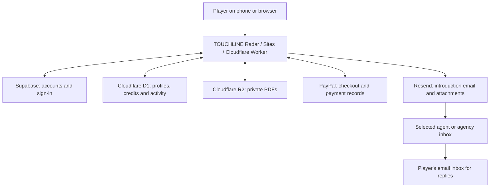

# TOUCHLINE Radar — where the data lives

Prepared for the owner on **16 October 2026 (Asia/Tashkent)**. This is a code/data-location handover, not an export of customer accounts or CVs. The code baseline is live Sites version 25, commit `3b5f2a155eba0a8339f6ad942387c1248dd449d5`. FREE3 was cancelled before deployment.

## The main distinction

**Your code, customer records, files, payments and emails are stored in different places.** Uploading the source to GitHub creates a code repository. It does not move the live website, existing purchases, accounts or uploaded PDFs.

## Service inventory

| What | Stored/uploaded where | What is there | In the source ZIP? |
| --- | --- | --- | --- |
| Application source | Local checkout and Sites-managed source repository/artifact storage | TypeScript/React components, APIs, styles, SQL migrations, server configuration | Yes |
| Running website | Sites hosting, executed on Cloudflare Workers | Deployed server code and public browser assets | Source included; live deployment itself stays on Sites |
| Public images, logo, fonts and map | `public/` in source, then deployed assets | Hero photo, radar branding, WOFF2 fonts, world map and public press facts | Yes |
| Agent/agency directory | `lib/directory.server.json`, bundled into the deployed server | Names, country/registration metadata, email arrays, phone arrays, licence/evidence metadata and destination grouping | Real file only in FULL_SOURCE_PRIVATE; GitHub-safe copy supplies a contact-free example |
| Player sign-in accounts | Supabase Auth, project `sdudyygdolyrkvwqbczd` | User IDs, emails, password hashes where applicable, Google identities, account timestamps, sessions | No account rows/passwords/tokens exported |
| Owner access registry | Supabase private schema `touchline_private` | Authorized owner UUID registry and admin helper functions | Schema/function definitions included; registry rows excluded |
| Saved player profiles | Managed Cloudflare D1 binding `DB`, table `agent_profiles` | Name, nationality, playing position, optional club/height/foot, links and biography | Schema included, customer rows excluded |
| Basic profile/account references | D1 `profiles` | Supabase user ID, email, name, creation time | Schema only |
| Uploaded CVs and other PDFs | Managed Cloudflare R2 binding `BUCKET` | Private PDF objects under `players/<userId>/<fileId>` | No PDFs exported |
| PDF metadata | D1 `agent_files` | File ID, owning user ID, filename, byte count and upload time | Schema only |
| Credit balances | D1 `agent_ledger` | Positive/negative credit entries, purpose, reason, owner and time; balance is calculated from entries | Schema only; private archive also retains one historical hard-coded grant migration |
| Contact reveals | D1 `agent_unlocks` | Which account unlocked which grouped recipient and when | Schema only |
| Introduction activity | D1 `agent_submissions` | Recipient/destination, owner, pending/sent/failed status, provider email ID, charge reference and time | Schema only |
| Website purchase records | D1 `agent_orders` | Credit quantity/type, amount/currency, PayPal order/capture references, status, capture-attempt marker and time | Schema only |
| Payment processing | PayPal | Checkout, funding method, transaction/fee/refund records and provider controls | No PayPal account or bank/card data exported |
| Outgoing introduction contents | Resend and the selected recipient's email provider | Generated HTML/plain-text message, profile information, PDF attachments, delivery events and reply address | Template code included; sent emails/provider logs excluded |
| Replies to introductions | Player's own email provider | Reply messages from the agent/agency | Not stored by this website's application code |
| Support requests | D1 `support_tickets` | Email, subject, message, optional order reference, owner ID when signed in, status and time | Schema only |
| Business mailbox | Zoho Mail account opened during setup for the site's contact address | Mail received at contact@touchlineradar.com and replies handled there | No mailbox messages or credentials exported |
| Payment webhook receipt log | D1 `payment_events` | Event IDs/types/processed times for duplicate handling | Schema only |
| Owner credit adjustments | D1 `agent_admin_audit` | Actor, customer target, adjustment details/reason and time | Schema only |
| Rate limiting | D1 `rate_limits` | Hashed request/account identifier, count and reset time | Schema only; no live counters exported |
| Policy acceptance | D1 `agreements` | User ID, agreement kind/version and acceptance time | Schema only |
| Legacy trial records | D1 `trials`, `orders`, `entitlements`, `refresh_runs`; old seed files in source | Historical trial-site data and legacy payment/entitlement structures | Schema/history remains; actual database rows excluded; seed contacts only in private source archive |
| Google login app | Google Cloud project `touchline-radar`, configured in Supabase | OAuth app name/branding, client credentials, authorized origins and callbacks | App code flag included; provider credentials/dashboard configuration excluded |
| Search indexing | Google Search Console | Ownership verification, sitemap, crawl and search-performance reports | SEO code/public verification strings included; Console account/reports excluded |
| DNS and domain routing | Cloudflare DNS and Sites custom-domain configuration | Website DNS, sending-domain SPF/DKIM/DMARC and Google verification records | Not recreated by source upload |
| Runtime secrets | Existing Sites runtime environment | PayPal secrets/IDs, Resend key, internal service token and non-secret settings | Values excluded; names and empty templates included |
| Traffic/performance analytics | Cloudflare Web Analytics where the public analytics component is rendered | Public-page/performance/referrer measurements, subject to the component's URL filters | Beacon code and its public analytics identifier included; reports excluded |

## The identifiers you need

- Live website: **https://touchlineradar.com/**.
- Sites project: `appgprj_6ac63839257c8191836a7b8f2acc0fa3`; runtime environment revision inspected: **9**.
- Hosting source provider reported by Sites: **cloudflare_artifact**, source branch `main`. This is not currently a GitHub repository you created.
- Supabase project: **TOUCHLINE Radar**, reference `sdudyygdolyrkvwqbczd`, region `eu-central-1`, healthy at inspection; PostgreSQL 17 reported.
- Supabase dashboard: https://supabase.com/dashboard/project/sdudyygdolyrkvwqbczd.
- Google Cloud project: `touchline-radar`.
- Required app storage bindings: D1 **DB** and R2 **BUCKET**. The native metadata used here did not expose their physical provider database/bucket IDs or an R2 object inventory. The example IDs in vite.config.ts are local placeholders.
- Both `touchlineradar.com` and `www.touchlineradar.com` were active with active TLS in Sites. The DNS provider is not proof of which registrar sold the domain.

## What happens when someone uses the website

**Registration/sign-in:** The website uses Supabase to verify the account. Google sign-in requests basic sign-in identity, not permission to read or send from a Gmail inbox. Application authorization uses the verified Supabase user ID. Display names may come from editable profile metadata, but owner rights are checked through the private admin registry/session checks.

**Saving a player profile:** The profile goes into D1, not Supabase Storage. There is no required age/date-of-birth field. Transfermarkt and highlights are optional URL strings; the site does not upload the linked videos or Transfermarkt profile itself. Unsaved form edits are held in the browser component state until saved.

**Uploading a PDF:** The server verifies the account, saves a private R2 object and creates a D1 metadata row. Downloads check that the requesting account owns the file. Current limits in code are three PDFs, up to 5 MB each and up to 8 MB combined. These files are separate from GitHub and the public image folder.

**Buying credits:** A PayPal checkout is associated with the account and credit purpose. D1 receives the order record. Credits are added only after server verification of the completed amount, currency, merchant and matching order. Funding/card information is handled by PayPal and the customer's bank; it is not collected by this app's database. The payment webhook verifies results; it does not initiate another collection.

**Revealing contact information:** The server checks the account and the contact-credit ledger, records the reveal and then returns that contact's email/available phone. Before purchase the public directory response omits those arrays. A customer can still copy or share information after revealing it; no source package or website can make disclosed contacts impossible to copy.

**Sending an introduction:** The server checks the saved profile, recipient and introduction balance. It records a credit reservation and pending submission. Resend receives the email text/HTML, selected recipient email, player reply address and all saved PDFs. The message is sent from TOUCHLINE Radar, with replies directed to the player. D1 stores delivery status and provider ID; the current submission table does not retain the full edited message or attachment bytes. Resend and the recipient's inbox hold the sent content. Removing a CV from the player's account does not remove copies already sent to recipients.

**Support:** The form records a D1 support ticket; its success message does not mean a notification email was sent. The business inbox is a separate mailbox. The private support retrieval endpoint requires the internal service token.

## Code/storage facts that matter for a move

1. **The paid directory is currently a server-side source file**, not a Supabase or D1 contacts table. A public copy of that file would expose the paid dataset. Keep FULL_SOURCE_PRIVATE private.
2. **Supabase is the account system, not the main application database.** Moving only Supabase will not move credit balances, payment records, player profiles or CVs.
3. **D1 and R2 are separately managed resources.** A full operational backup needs the real D1 contents and R2 objects in addition to code. No such personal-data backup was requested or generated here.
4. **User IDs connect the systems.** Preserve account IDs when migrating; generating new accounts can disconnect existing balances/files from their owners.
5. **Provider configuration is external.** Google consent branding, Supabase provider/SMTP settings, PayPal app/webhook configuration, Resend sending-domain verification, DNS and Search Console ownership do not move with a Git commit.
6. **Legacy trial functionality is retired, but historical schema/source remains.** Old routes return retirement responses; the old daily refresh automation was already paused. No legacy tables or customer history were deleted during this handover.
7. **Source exports are not comprehensive backups.** Secrets, current sessions, live database rows, private CV objects, inboxes, provider logs and dashboard settings remain in their services.

## Browser and analytics details

Sign-in sessions use secure/HTTP-only cookies on the HTTPS site. The application source does not use localStorage/sessionStorage for player profiles. Cloudflare/hosting providers can process request IPs and operational logs; the app's rate-limit keys are hashed. Public analytics code allows only selected public URLs and blocks sensitive query/referrer paths. Its use is separate from any provider's operational logging.

Fonts are currently served from the site's own public font files. Some privacy-page wording mentions Google Fonts, but this handover found local font-face URLs and no external font import in the current CSS. External player video/Transfermarkt links open third-party services when followed.

No TikTok/Meta advertising-pixel code was found in the current application source during this check. Videos posted to TikTok and Instagram are held on those platforms independently; changing this website source does not delete those posts.

## Scope of verification

The map was checked against the current source, native Sites metadata (bindings/table names, domains and runtime variable names) and Supabase project/admin-function metadata. Customer rows, uploaded PDFs, passwords and provider message bodies were not dumped. Provider retention periods, geographic storage of every email/file copy, backup schedules and all dashboard settings were not independently verified; do not infer them from a region or provider name.
